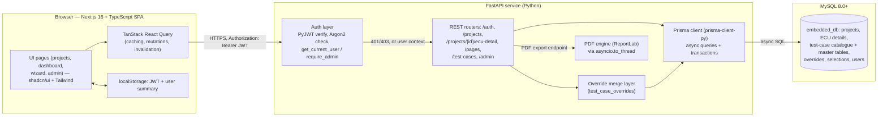
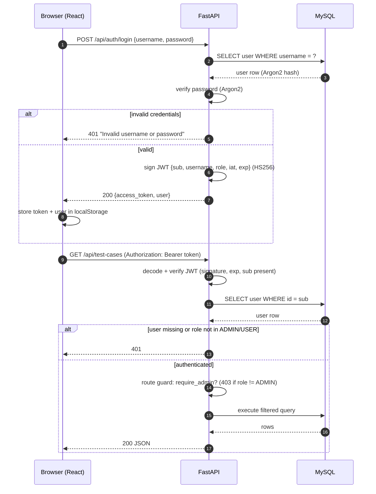
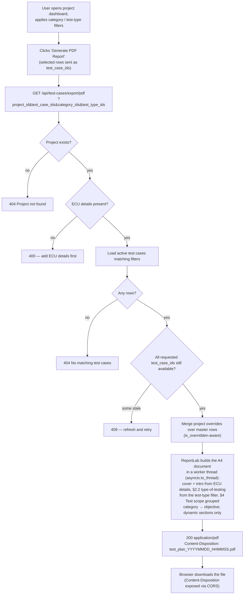
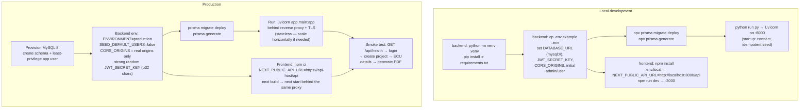

# ECU Security Testing & Test Plan Management — Technical Document

**Audience:** Architects, developers, engineering managers, cybersecurity teams, DevOps teams, technical leadership.

**Scope of this document:** describes the application **as it exists today** in this repository. Items that are not yet implemented are marked **(proposed)** and collected in the roadmap.

---

## 1. Executive Summary

This application is a full-stack web system for managing the cybersecurity testing of automotive Electronic Control Units (ECUs) and producing a penetration-testing test plan per project.

- **Frontend:** Next.js 16 (App Router), React 19, TypeScript, Tailwind CSS v4, shadcn/ui, TanStack React Query.
- **Backend:** FastAPI (Python) with a Prisma client (`prisma-client-py`) over **MySQL 8**.
- **AuthN/AuthZ:** JWT bearer tokens (HS256), Argon2 password hashing, two roles (`ADMIN`, `USER`) enforced server-side.
- **Data:** normalized master-data tables (categories, objectives, protocols, attack vectors, test types, severities, threats, assets, tools, references) referenced by a central `test_cases` catalogue; per-project **overrides** customize text/tools/references without touching the master catalogue.
- **Output:** a professionally formatted **PDF test plan** (ReportLab) generated per project from filtered catalogue data plus the project's ECU details.

The system separates concerns cleanly: one shared, admin-maintained test-case catalogue; project-scoped customization via soft overrides; a deterministic, server-rendered PDF.

---

## 2. Problem Statement

Before this application, preparing a penetration-testing test plan for an ECU was a manual document exercise:

1. A standard test-plan template (the structure mirrored by `pdf.html` at the repository root) had to be copied and re-populated for every project.
2. The list of candidate tests lived in a catalogue (categories → objectives → actions) that was hard to keep current and consistent across projects.
3. Project-specific wording, tools, and references had to be hand-edited into each copy of the document, with no reliable way to trace which values came from the master catalogue and which were project edits.
4. Reusing or extending catalogue values (new tool name, new threat text) risked typos and divergence.
5. There was no access control, audit field, or system of record for who changed which test case.

Consequences: slow per-project setup, inconsistent documents, uncontrolled catalogue drift, and no audit trail.

---

## 3. Objectives and Scope

### Objectives

- Provide a **single source of truth** for the security test-case catalogue, editable by admins only.
- Let any authenticated user build **project-scoped test plans**: create a project, record ECU details, pick the applicable tests, customize wording where needed, and export a PDF.
- Keep master data **normalized** so a value (e.g., a tool name) is stored once and referenced many times.
- Enforce **authentication, role-based authorization, and data integrity** at the API layer.
- Produce a test-plan PDF that matches the existing corporate template structure.

### In scope (implemented)

- JWT login and role-based access (ADMIN / USER).
- Project management (create, list, read) and one ECU-detail record per project.
- Four-step **configuration wizard** (attribute groups/attributes with per-project selections).
- Admin CRUD for test cases with soft deletion and audit fields.
- Existing-value pickers with inline **new-value creation** for lookup tables.
- Test-case filtering by category and test type (multi-select, plus "Both" wildcard).
- Per-project test-case overrides (text fields, tools, references) with merge-on-read.
- PDF test-plan generation per project with overrides applied.

### Out of scope (not implemented — see §19)

- Test *execution* tracking, findings management, and reporting on results.
- SSO/SAML, refresh tokens, user self-service, MFA.
- Configurable PDF sections beyond those currently populated from data.

---

## 4. Functional Modules

| # | Module | Description |
|---|--------|-------------|
| 1 | **Authentication & RBAC** | Login endpoint, JWT issuance/verification, `get_current_user` and `require_admin` FastAPI dependencies. |
| 2 | **Project management** | Create/list/read projects; one ECU-detail record per project (name, part number, risk rating, architecture, vehicle line, year, MCU provider, three availability dates, export-control classification, pentest provider). |
| 3 | **Configuration wizard** | Four pages of attribute groups; each group has selectable attributes; per-project selections are stored as a full replacement set per page. |
| 4 | **Test-case catalogue (admin)** | Admin-only CRUD over `test_cases` with all master-data relations, multi-select tools/references, soft delete, audit fields, statistics. |
| 5 | **Lookup management** | Admin endpoints to list and idempotently create master-data values (protocols, attack vectors, test types, threats, assets, tools, references). |
| 6 | **Dashboard & filtering** | Authenticated users browse active test cases filtered by category and test type; expandable detail view; per-project "Edited" badges. |
| 7 | **Project overrides** | Users customize editable text fields, tools, and references per project; master rows are never modified; a reset restores master values. |
| 8 | **PDF generation** | Server-side ReportLab rendering of the test-plan document per project, respecting filters and overrides. |

---

## 5. User Roles and Authorization

Two roles, stored in `users.role`:

| Capability | USER | ADMIN |
|------------|:----:|:-----:|
| Login, `GET /auth/me` | ✅ | ✅ |
| Projects: list / create / read | ✅ | ✅ |
| ECU details: get / create / update | ✅ | ✅ |
| Configuration wizard: attributes & selections | ✅ | ✅ |
| Test cases: browse, filter, single read, tools/references lists | ✅ | ✅ |
| Project overrides: create/update / reset | ✅ | ✅ |
| PDF export | ✅ | ✅ |
| Admin catalogue: list / read / create / update / soft-delete | ❌ | ✅ |
| Admin lookups list, field suggestions, lookup creation, stats | ❌ | ✅ |

Enforcement model:

- Every protected endpoint depends on `get_current_user`, which verifies the bearer JWT and **re-loads the user row from the database** (a deleted or role-changed user is rejected even with a valid token).
- Admin endpoints additionally depend on `require_admin`, which returns **403** for non-ADMIN roles.
- Only `ADMIN` and `USER` are accepted roles at the API layer.
- Users are provisioned out-of-band: an idempotent startup seed creates the configured development admin/user (disabled in production via `SEED_DEFAULT_USERS=false`); production accounts are created in the database directly. **(Proposed: user-management API/UI.)**

---

## 6. Technology Stack

| Layer | Technology | Notes |
|-------|-----------|-------|
| UI framework | Next.js 16 (App Router) + React 19 + TypeScript | Server/client components, route-based pages |
| UI components | shadcn/ui (Radix primitives), Tailwind CSS v4, lucide icons | Design-system consistency |
| Data fetching | TanStack React Query v5 | Caching, mutations, query invalidation |
| Tables | TanStack React Table v8 | Dashboard tables |
| API framework | FastAPI (Python) | Async, Pydantic v2 validation, OpenAPI docs at `/docs` |
| ORM / data access | Prisma (`prisma-client-py` 0.15) | Typed client; migrations under `backend/prisma/migrations` |
| Database | MySQL 8.0+ | `utf8mb4`; async access via Prisma |
| Auth | PyJWT (HS256/384/512), `pwdlib` (Argon2) | Bearer tokens; hashed passwords only |
| Config | Pydantic Settings + `.env` | Validated at startup (fail-fast) |
| PDF | ReportLab (SimpleDocTemplate/Platypus) | CPU-bound build offloaded to a worker thread |
| Runtime | Uvicorn (ASGI) | `run.py` dev entry; `next start` for the frontend |

---

## 7. System Architecture

Three tiers with a strict client/server split. All business rules, authorization, and PDF rendering live in the backend; the frontend is a stateless SPA-style client that stores only the JWT and user summary.



Key properties:

- **Stateless API:** every request is independently authenticated via the JWT; no server session.
- **Fail-fast configuration:** `app/config.py` validates `DATABASE_URL` (must be `mysql://`), the JWT secret (min 32 chars, weak values rejected), the algorithm (HMAC only), CORS origins (wildcards rejected), and production guards (no default-user seeding, no localhost origins) **before the app starts**.
- **Idempotent startup:** on boot the app connects to MySQL and idempotently ensures the four wizard attribute pages and (in development) the default users exist.

---

## 8. Database Design

Modeled in `backend/prisma/schema.prisma` (MySQL, `prisma-client-py`). Migrations: `20260907092929_init`, `...add_users_and_audit_columns`, `...add_test_case_soft_delete`, `...add_users`.

Normalization principles:

- Every reusable value (category, objective, protocol, attack vector, test type, severity, threat, asset, tool, reference) exists **exactly once** in a master table with a unique name constraint.
- `test_cases` reference master tables by foreign key; many-to-many links (tools, references) go through junction tables.
- Project customization never writes to `test_cases`: it writes to `project_test_case_overrides`, merged on read.
- Audit: `test_cases` carries `created_by`, `updated_by`, `deleted_by`, `created_at`, `updated_at` and a **soft-delete** flag (`deleted_at`).

```mermaid
erDiagram
    users ||--o{ test_cases : "created_by"
    users ||--o{ test_cases : "updated_by"
    users ||--o{ test_cases : "deleted_by"
    projects ||--o| project_ecu_details : "has one"
    projects ||--o{ project_selections : "has"
    projects ||--o{ project_test_case_overrides : "has"
    categories ||--o{ objectives : "contains"
    categories ||--o{ test_cases : "classifies"
    objectives ||--o{ test_cases : "scopes"
    protocols |o--o{ test_cases : "optional"
    attack_vectors |o--o{ test_cases : "optional"
    test_types |o--o{ test_cases : "optional"
    severities |o--o{ test_cases : "optional"
    threats |o--o{ test_cases : "optional"
    assets |o--o{ test_cases : "optional"
    test_cases ||--o{ test_case_tools : "has"
    tools_master ||--o{ test_case_tools : "linked"
    test_cases ||--o{ test_case_references : "has"
    references_master ||--o{ test_case_references : "linked"
    test_cases ||--o| project_test_case_overrides : "overridden"
    project_test_case_overrides ||--o{ project_test_case_override_tools : "has"
    tools_master ||--o{ project_test_case_override_tools : "linked"
    project_test_case_overrides ||--o{ project_test_case_override_references : "has"
    references_master ||--o{ project_test_case_override_references : "linked"
    attribute_groups ||--o{ attributes : "contains"
    attributes ||--o{ project_selections : "selected"

    users {
        bigint id PK
        string username UK
        string password "Argon2 hash"
        string role "ADMIN | USER"
        datetime created_at
        datetime updated_at
    }
    projects {
        int id PK
        string name
        string description
        datetime created_at
    }
    project_ecu_details {
        int id PK
        int project_id FK,UQ "unique per project"
        string ecu_name
        string part_number
        string ecu_risk_rating
        string architecture
        string vehicle_line
        int year
        string microcontroller_cpu_provider
        date date_hardware_b_sample_available
        date date_harness_available
        date date_production_intent_software_available
        string export_control_classification
        string pentest_provider_name
        datetime created_at
        datetime updated_at
    }
    categories {
        bigint id PK
        string name UK
        datetime created_at
    }
    objectives {
        bigint id PK
        bigint category_id FK
        string name
    }
    test_cases {
        bigint id PK
        bigint category_id FK
        bigint objective_id FK
        bigint protocol_id FK,nullable
        bigint attack_vector_id FK,nullable
        bigint test_type_id FK,nullable
        bigint severity_id FK,nullable
        bigint threat_id FK,nullable
        bigint asset_id FK,nullable
        string action_test_case
        string source_scope_status
        string description
        string attack_path
        string test_steps
        string expected_output
        string attack_feasibility
        string cia_impact
        string safety_impact
        string automation_possible
        bigint created_by FK
        bigint updated_by FK
        bigint deleted_by FK,nullable
        datetime created_at
        datetime updated_at
        datetime deleted_at "soft delete"
    }
    protocols {
        bigint id PK
        string name UK
    }
    attack_vectors {
        bigint id PK
        string name UK
    }
    test_types {
        bigint id PK
        string name UK
    }
    severities {
        bigint id PK
        string name UK
        int severity_rank
    }
    threats {
        bigint id PK
        string threat_text UK
    }
    assets {
        bigint id PK
        string asset_name UK
    }
    tools_master {
        bigint id PK
        string tool_name UK
    }
    references_master {
        bigint id PK
        string ref_text UK
    }
    test_case_tools {
        bigint test_case_id PK,FK
        bigint tool_id PK,FK
    }
    test_case_references {
        bigint test_case_id PK,FK
        bigint reference_id PK,FK
    }
    project_test_case_overrides {
        int id PK
        int project_id FK,UQ "unique per (project, case)"
        bigint test_case_id FK,UQ
        string action_test_case nullable
        string source_scope_status nullable
        string description nullable
        string attack_path nullable
        string test_steps nullable
        string expected_output nullable
        string attack_feasibility nullable
        string cia_impact nullable
        string safety_impact nullable
        string automation_possible nullable
        bool tools_overridden
        bool references_overridden
        datetime created_at
        datetime updated_at
    }
    project_test_case_override_tools {
        int override_id PK,FK
        bigint tool_id PK,FK
    }
    project_test_case_override_references {
        int override_id PK,FK
        bigint reference_id PK,FK
    }
    attribute_groups {
        int id PK
        int page "1-4"
        string name
    }
    attributes {
        int id PK
        int group_id FK
        string name
    }
    project_selections {
        int id PK
        int project_id FK
        int attribute_id FK
        int page
    }
```

Notable constraints:

- `objectives` unique on `(category_id, name)`; master tables unique on their name/text columns.
- `project_selections` unique on `(project_id, attribute_id)`; `project_test_case_overrides` unique on `(project_id, test_case_id)`.
- `project_ecu_details.project_id` unique — one ECU record per project.
- All FKs are indexed; soft-delete queries always filter `deleted_at IS NULL`.

### Merge rule for overrides

A non-NULL override column replaces the master value; `NULL` means "not overridden"; an empty string means "explicitly cleared for this project". `tools_overridden` / `references_overridden` flags distinguish "replace with this set (possibly empty)" from "use master links". An override row that ends up overriding nothing is deleted, so `is_overridden` never reports a no-op edit.

---

## 9. API Design

Base path `/api`. JSON over HTTPS; authentication via `Authorization: Bearer <JWT>` on all endpoints except login and health. Conventions: `400` bad input, `401` missing/invalid token, `403` insufficient role, `404` not found, `409` conflict, `422` validation failure.

### Authentication

| Method | Path | Auth | Purpose |
|--------|------|------|---------|
| POST | `/auth/login` | public | Verify credentials, return `access_token` + user |
| GET | `/auth/me` | any | Current user (token verification round-trip) |

### Projects & ECU details

| Method | Path | Auth | Purpose |
|--------|------|------|---------|
| GET | `/projects` | any | List projects (newest first) |
| POST | `/projects` | any | Create project (name, description) |
| GET | `/projects/{id}` | any | Read project |
| GET | `/projects/{id}/ecu-detail` | any | Read ECU details (404 if absent) |
| POST | `/projects/{id}/ecu-detail` | any | Create ECU details (409 if exists) |
| PUT | `/projects/{id}/ecu-detail` | any | Partial update of supplied fields |

### Configuration wizard

| Method | Path | Auth | Purpose |
|--------|------|------|---------|
| GET | `/pages/{page}/attributes` | any | Attribute groups + attributes for page (1–4) |
| GET | `/projects/{id}/page/{page}/selections` | any | Saved selections for page |
| PUT | `/projects/{id}/page/{page}/selections` | any | **Replace** all selections for the page (empty list clears) |

### Test cases (catalogue reads + PDF)

| Method | Path | Auth | Purpose |
|--------|------|------|---------|
| GET | `/test-cases/categories` | any | All categories |
| GET | `/test-cases/types` | any | All test types |
| GET | `/test-cases/tools` | any | Tool options for override editing |
| GET | `/test-cases/references` | any | Reference options for override editing |
| GET | `/test-cases?project_id&category_ids&test_type_ids` | any | Filtered active cases; overrides merged when `project_id` given (legacy single `category_id`/`test_type_id` accepted, deprecated) |
| GET | `/test-cases/{id}?project_id` | any | Single active case, optionally override-merged |
| GET | `/test-cases/export/pdf?project_id&test_case_ids&category_ids&test_type_ids` | any | Generate the project test-plan PDF (see §14) |

### Project overrides

| Method | Path | Auth | Purpose |
|--------|------|------|---------|
| PUT | `/projects/{id}/test-cases/{caseId}` | any | Upsert the project's override (text fields verbatim; `tools`/`references` are full replacement sets; `null` leaves master) |
| DELETE | `/projects/{id}/test-cases/{caseId}` | any | Reset: delete the override, master values apply again |

### Admin (ADMIN only)

| Method | Path | Purpose |
|--------|------|---------|
| GET | `/admin/test-cases` | List active cases with full relations (newest first) |
| GET | `/admin/test-cases/{id}` | Read one active case |
| POST | `/admin/test-cases` | Create case (validates all FKs, objective–category match, duplicate guard; transactional insert of junction rows) |
| PUT | `/admin/test-cases/{id}` | Partial update; junction sets replaced only when supplied |
| DELETE | `/admin/test-cases/{id}` | **Soft delete**: set `deleted_at`, `deleted_by` |
| GET | `/admin/lookups` | All master-data lists for the admin form |
| POST | `/admin/lookups/{type}` | Idempotent create-or-return for `protocols`, `attack_vectors`, `test_types`, `threats`, `assets`, `tools`, `references` |
| GET | `/admin/field-suggestions` | Distinct previously-used values per free-text field |
| GET | `/admin/stats` | `total_test_cases`, `total_users`, `recent_updates` (7 days) |

### Health

| Method | Path | Auth | Purpose |
|--------|------|------|---------|
| GET | `/health` | public | Liveness probe |

---

## 10. Security Design



Controls in place:

- **Passwords:** Argon2 hashes via `pwdlib` (`PasswordHash.recommended()`); plaintext is never stored; verification failures are caught and treated as invalid.
- **Tokens:** JWT with `sub` (user id), `username`, `role`, `iat`, `exp`; default lifetime 60 minutes, configurable 1–1440; HMAC-only algorithm allow-list (HS256/384/512). The token is signed with a secret that must be ≥32 characters; known placeholder/weak values are **rejected at startup**.
- **Authorization:** per-endpoint FastAPI dependencies; role is re-read from the database on every request, so revocation (role change/deletion) takes effect immediately on the next call.
- **CORS:** explicit origin allow-list; wildcards rejected when credentials are enabled; production configuration must not contain localhost origins.
- **Input validation:** Pydantic models on every request; server-side existence checks for every supplied FK (422 before any write); text fields trimmed/normalized.
- **Configuration integrity:** fail-fast Pydantic Settings validation of `DATABASE_URL`, secrets, CORS, and environment guards (production forbids default-user seeding and localhost CORS).
- **PDF rendering:** all dynamic text is HTML-escaped before insertion into the document.
- **Least-effort data exposure:** error bodies carry generic details; user rows never expose the password hash.

Known security limitations (honest inventory, see §18): the JWT is stored in `localStorage` (exposed to XSS), there is no refresh-token flow, no rate limiting or account lockout, and no centralized application audit log table (audit fields exist on `test_cases` only). All are on the roadmap.

---

## 11. Admin Test-Case Management

Admins manage the shared catalogue from `/admin` (stats dashboard) and `/admin/test-cases` (CRUD).

- **Create:** full form with all master-data pickers, multi-select tools/references, and the long-text fields (description, attack path, test steps, expected output, feasibility, CIA impact, safety impact, automation).
- **Update:** partial updates; tool/reference sets are replaced only when explicitly supplied; the row's `updated_by` is stamped.
- **Delete:** soft delete (`deleted_at`, `deleted_by`); deleted cases are invisible to every list, filter, dashboard, override, and PDF path, and free their `(objective, action)` slot for reuse.
- **Audit:** `created_by` / `updated_by` / `deleted_by` + timestamps on every case; admin stats endpoint exposes catalogue size and 7-day change activity.

```mermaid
sequenceDiagram
    autonumber
    participant U as Admin UI
    participant A as FastAPI /api/admin
    participant D as MySQL

    U->>A: GET /lookups (categories, objectives, protocols, vectors, types, severities, threats, assets, tools, references)
    A-->>U: all master-data lists
    U->>A: GET /field-suggestions
    A-->>U: distinct previously-used values per text field

    U->>A: POST /test-cases {category_id, objective_id, ..., tool_ids[], reference_ids[]}
    A->>A: strip/validate required fields (422 if blank action)
    A->>D: verify every FK exists
    Note over A,D: 422 if any lookup id is unknown
    A->>D: objective.category_id == category_id?
    Note over A,D: 422 if the objective does not belong to the category
    A->>D: SELECT active case with same (objective_id, action_test_case)
    Note over A,D: 409 Conflict if duplicate exists
    A->>D: BEGIN transaction
    A->>D: INSERT test_cases (created_by = admin id, updated_by = admin id)
    A->>D: INSERT test_case_tools rows (deduped, sorted)
    A->>D: INSERT test_case_references rows (deduped, sorted)
    A->>D: COMMIT
    A-->>U: 201 + full case with relations

    opt admin types a brand-new tool name in the form
        U->>A: POST /lookups/tools {name}
        A->>D: find by name, else INSERT
        A-->>U: 201 {id, name} (idempotent: returns existing row)
        U->>A: invalidate & reload lookups; new item auto-selected
    end
```

---

## 12. Existing-Value Selection and New-Value Creation

Every master-data field in the admin form is a **combo picker** with two modes:

1. **Select existing:** the picker is populated from `GET /admin/lookups` (all values, sorted; severities ordered by `severity_rank`).
2. **Create new:** the admin can type a value that does not exist yet. Saving calls `POST /admin/lookups/{type}`, which is **idempotent** — it returns the existing row if the name already exists (guarding against races and duplicates), otherwise inserts and returns the new row. The form then refreshes lookups and auto-selects the new item.

Supported creation targets: protocols, attack vectors, test types, threats, assets, tools, references. (Categories and objectives come from the seeded/master structure; see §13. **(Proposed: admin management of categories/objectives.)**)

For the **free-text fields** (description, attack path, test steps, expected output, feasibility, CIA impact, safety impact, source/scope/status), the form offers **quick-pick suggestions** from `GET /admin/field-suggestions`: the distinct, previously-used values in the active catalogue for that field. Choosing a suggestion normalizes wording across the catalogue without forcing a hard constraint; "Other" leaves the field free-form.

This "pick or create" pattern is what keeps the catalogue normalized: one row per concept, referenced by id everywhere else.

---

## 13. Category and Objective Relationship

- `categories` **1—N** `objectives`: each objective belongs to exactly one category (`objectives.category_id`); the pair `(category_id, name)` is unique.
- `test_cases` reference **both** a category and an objective, and the API enforces consistency: the chosen objective's `category_id` must equal the case's `category_id` (otherwise 422 "Selected objective does not belong to the selected category").
- In the admin form the pickers **cascade**: selecting a category narrows the objective picker to that category's objectives.
- In reports and the PDF, test cases are grouped **by category first, then by objective**, which mirrors the structure of the corporate template's "Test scope" section.
- Category/objective are the stable classification axes: they drive dashboard filtering and PDF grouping, and they are **read-only** in project overrides (only text, tools, and references can be customized per project).

---

## 14. Search, Filtering, and PDF-Generation Flow

### Filtering model (dashboard and PDF share it)

- `category_ids` (multi) and `test_type_ids` (multi) are normalized (deduped, sorted); legacy single `category_id` / `test_type_id` query params are still accepted (deprecated).
- **"Both" wildcard:** if the selected test types include one named `Both`, the type filter is cleared and all types are returned (the raw selection is still reported in the PDF metadata).
- All queries are restricted to `deleted_at IS NULL`.
- When `project_id` is supplied, each row is merged with that project's override and flagged `is_overridden`.
- **(Proposed):** full-text search, severity/protocol/asset filters, pagination.

### PDF generation



Document structure (mirrors the `pdf.html` template): cover page (ECU name, platform, date) → distribution list + document history → contents → §1 Introduction (populated from the project's ECU details) → §1.1 supporting documentation, §1.2 roles → §2 Testing approach (attacker model; §2.2 type-of-testing Y/N derived from the selected test types; assumptions) → §3 Schedules and deliverables → **§4 Test scope** (all filtered test cases, grouped by category banner → objective) → references → appendices A–C.

Sections 1, 2.2, and 4 are **dynamic** (driven by project data, filters, and overrides). The remaining sections currently carry static template content because the application has no data model for them yet **(proposed: make them project-configurable — see §19)**.

---

## 15. Error Handling and Data Integrity

### Error handling

- **Consistent status semantics:** 400 (bad input, e.g., unknown override tool ids), 401 (authn), 403 (authz), 404 (missing project/case/override; empty filter results for PDF), 409 (conflicting state: duplicate ECU detail, duplicate objective+action, stale PDF selection), 422 (validation: unknown FK ids, category/objective mismatch, blank required text, out-of-range wizard page).
- **Frontend parity:** React Query mutations surface API `detail` messages; the PDF button has explicit loading and error states with actionable messages (e.g., 409 → "refresh the dashboard and try again").
- **Idempotent endpoints:** lookup creation and the override upsert are safe to retry.

### Data integrity

- **Referential integrity** enforced by MySQL FK constraints on every relation; the API additionally pre-validates FK ids with helpful 422s instead of opaque constraint errors.
- **Uniqueness:** master-table names are unique; objective names unique per category; one ECU detail per project; one selection per (project, attribute); one override per (project, test case).
- **Transactions:** multi-row writes (test case + junction rows; selection replacement; override link sets) execute inside Prisma transactions — all-or-nothing.
- **Soft delete:** test cases are never hard-deleted; every read path filters `deleted_at IS NULL`; audit columns preserve who/when.
- **Upsert + flags:** overrides use `upsert` on the composite key plus explicit `tools_overridden`/`references_overridden` flags, so "cleared" and "not overridden" are never ambiguous.
- **Idempotent seed:** wizard attributes and dev users are created-if-missing on boot; existing passwords are never overwritten.
- **Fail-fast startup:** invalid configuration prevents the API from serving traffic at all.

---

## 16. Deployment Flow



Notes:

- Configuration is **100% environment-driven** (`.env` / container env); nothing is hardcoded. The settings layer validates it and refuses to boot on weak or insecure values.
- There is no container image or CI pipeline in the repository today **(proposed: Dockerfiles, CI lint/test/build gates, migration step in the release pipeline)**.
- The PDF endpoint is CPU-bound but runs in a worker thread, so a single Uvicorn process handles it without blocking the event loop; scale out horizontally if PDF demand grows (stateless API).
- Database backups: standard MySQL backup/restore applies; the schema is migration-managed under `backend/prisma/migrations`.

---

## 17. Detailed Application Example

**Actors:** `admin` (cybersecurity engineer), `m.brown` (project security engineer, role USER).

### Step 1 — Admin extends the catalogue

1. `admin` logs in → receives a 60-minute JWT; browser stores it.
2. Opens **Admin → Test Cases** → **New**.
3. Picks category **Communication** → the objective picker now lists only Communication objectives; picks **Firmware update integrity**.
4. Selects protocol **UDS**, attack vector **Malicious OTA update**, test type **Black-box**, severity **High**; asset **ECU**.
5. In the action/test-case field: *"Replay a previously captured, unauthenticated OTA package and verify the ECU rejects it."*
6. Tools picker: selects existing **CANoe**, then types a new tool **Firmware Fuzzer X** and saves — `POST /admin/lookups/tools` returns its new id and the picker auto-selects it.
7. Free-text fields (test steps, expected output) are filled partly from the **suggestions** dropdown of previously-used values, partly free-form.
8. `POST /admin/test-cases` → server verifies every FK, the objective/category match, and the duplicate guard → transactional insert with `created_by=admin` → **201**.
9. The admin stats card shows `total_test_cases` incremented.

### Step 2 — User builds a project test plan

1. `m.brown` logs in, creates project **"VG-2026 Vehicle Gateway"** with a description.
2. On the project dashboard, fills the **ECU details** card: name, part number `VG-88213`, risk rating **High**, architecture, vehicle line, year 2026, MCU provider, B-sample / harness / production-software dates, export-control classification, pentest provider → **201** (a second create would 409).
3. Optionally walks the **configuration wizard** pages 1–4, saving selections per page (full replacement semantics).
4. On the **Test Cases** dashboard, filters: category *Communication*, test types *Black-box*. The new case appears.
5. Expands the row; opens the detail dialog in edit mode and adjusts the **test steps** for this project's tooling → `PUT /api/projects/{id}/test-cases/{caseId}` creates an override; the row now shows an **Edited** badge. The master catalogue is untouched — other projects still see the original text.
6. Selects the desired rows and clicks **Generate PDF Report** → `GET /api/test-cases/export/pdf?project_id=…&test_case_ids=…&category_ids=…` → server confirms ECU details exist, loads matching active cases, validates the selection, **merges the override**, builds the document → downloads `test_plan_20260917_143012.pdf`.
7. The PDF's cover and §1 Introduction carry the project's ECU details; §2.2 marks **Black-box = Y**; §4 Test scope lists the Communication category with the **edited** test-step wording for that one case.

### Step 3 — Audit

Later, an admin reviews the catalogue: the case shows `created_by=admin`, and any project-side change is visible in the project's override rows (`created_at`/`updated_at`) — without ever having altered the master record.

---

## 18. Current Limitations

**Functional**

1. **Static PDF sections.** Distribution list, document history, supporting documents, roles, attacker model, limitations, assumptions, schedules, references, and appendices A–C carry static template content; only sections 1, 2.2, and 4 are data-driven.
2. **No execution tracking.** The tool plans tests; it does not record test execution, results, findings, or remediation.
3. **Filtering is category + test type only.** No full-text search, severity/protocol/asset filters, or pagination (admin list returns all active cases).
4. **No project ownership/isolation.** Every authenticated user can view and override every project; there is no per-project permissioning and no project delete.
5. **Categories/objectives are not admin-manageable** through the API/UI (created in master data; only the seven other lookup tables support inline creation).

**Security & platform**

6. JWT stored in `localStorage` (XSS-exposed); no refresh tokens; no rate limiting, lockout, or MFA/SSO.
7. No user self-service: accounts are seeded (dev) or provisioned manually (prod); no password reset or user-management UI.
8. No centralized audit log table (audit fields exist on test cases; overrides and ECU details have timestamps only).
9. No container image, CI/CD pipeline, or load testing in the repository; the PDF endpoint scales out only with horizontal replication.
10. Legacy SQLAlchemy scaffolding (`app/database.py`, `app/models.py`) remains in the codebase alongside the Prisma stack — technical debt to remove.
11. No automated test suite in the repository.

---

## 19. Future Roadmap

Prioritized, all items are **proposed** (none are implemented):

1. **User management & enterprise auth:** user CRUD API/UI, password reset, SSO (OIDC/SAML), refresh tokens, optional MFA.
2. **Configurable PDF sections:** data models + admin UI for distribution list, document history, supporting documents, roles, attacker model, assumptions, schedules, and references; per-project document versioning.
3. **Catalogue growth:** admin management of categories/objectives; full-text search; severity/protocol/asset filtering; pagination; bulk import/export (CSV/Excel) of the catalogue.
4. **Execution & findings:** per-project test execution status, results capture, findings with severity and remediation tracking, re-test scheduling.
5. **Governance:** centralized audit log (who/what/when across all writes), project ownership and role-based project access, change notifications.
6. **Compliance alignment:** mapping tests to standards (e.g., ISO/SAE 21434, UN R155) and compliance-ready reporting.
7. **Platform hardening:** Docker images, CI/CD (lint, type-check, tests, migration gate), rate limiting, request signing, penetration testing of the platform itself; removal of legacy SQLAlchemy code; add an automated test suite.

---

## 20. Conclusion

The application delivers a coherent, role-secured, normalized data platform for ECU security test planning: an admin-owned catalogue with pick-or-create master data, project-scoped soft overrides, and a deterministic server-rendered PDF that matches the corporate template. Its architecture (stateless JWT-authenticated API, transactional Prisma/MySQL data layer, worker-thread PDF rendering) is straightforward to operate and to extend. The most valuable next steps are user-management/SSO, configurable PDF sections, and execution tracking — each an extension of the existing patterns rather than a re-architecture.

---

## Key Takeaways

- One normalized master catalogue; per-project overrides; **master rows are never mutated by users**.
- JWT + DB re-check + two roles give simple, immediately-revocable authorization.
- Data integrity via FKs, unique constraints, transactions, soft delete, and audit fields.
- PDF output is server-rendered, filter- and override-aware, and off-thread.
- Main gaps: static PDF sections, no execution tracking, no SSO/user self-service, no automated tests.

## Next Steps

1. Provision a staging environment (MySQL 8 + production-guarded env) and run the smoke path from §16.
2. Define the pilot program set and catalogue ownership model (named admin).
3. Sequence roadmap items 1–2 (user management; configurable PDF sections).
4. Add automated tests (API-level FastAPI tests + a Playwright flow for the PDF happy path) before broader rollout.

## Assumptions

- A MySQL 8-compatible server is available and backed up; the DBA can create the schema and a least-privilege app user.
- The corporate template structure in `pdf.html` remains the target document format.
- Initial catalogue (categories, objectives, seeded test cases) is provided by the security team.
- Users will operate the system in a modern browser over HTTPS with the internal network/VPN.

## Limitations

- This document reflects the current repository state; features marked **(proposed)** are not implemented.
- No measured performance, availability, or adoption figures are stated; none have been collected yet (see the business document's KPI section for how to measure them).
- The static PDF sections must be reviewed manually before a generated plan is circulated.

## Glossary

| Term | Meaning |
|------|---------|
| ECU | Electronic Control Unit — a computer inside a vehicle that controls one or more functions. |
| JWT | JSON Web Token — a signed, self-contained, expiring credential sent as a Bearer token. |
| RBAC | Role-Based Access Control — permissions granted via roles (here: ADMIN, USER). |
| Bearer token | Authorization header value (`Authorization: Bearer <jwt>`) that authenticates a request. |
| Argon2 | Memory-hard password hashing algorithm used to store user passwords. |
| Prisma | ORM/data-access layer; here the `prisma-client-py` async client over MySQL. |
| Migration | A versioned schema change script; migrations live in `backend/prisma/migrations`. |
| Master data / lookup table | A table holding a canonical list of reusable values (e.g., tools, threats). |
| Junction (link) table | Holds a many-to-many relationship (e.g., `test_case_tools`). |
| Normalized | Data stored once and referenced by id, avoiding duplication. |
| Soft delete | Marking a row deleted (`deleted_at`) instead of removing it; preserved for audit. |
| Override | A project-scoped row that customizes a master test case's text/tools/references. |
| Upsert | Insert-or-update on a key, used for overrides and idempotent lookups. |
| Idempotent | An operation that yields the same result no matter how many times it is retried. |
| ReportLab | Python library used to render the PDF test plan. |
| CORS | Cross-Origin Resource Sharing — browser policy controlling which origins may call the API. |
| Worker thread | Non-async OS thread; the blocking PDF build runs there via `asyncio.to_thread`. |
| "Both" wildcard | A special test-type value that, when selected, disables the test-type filter. |
